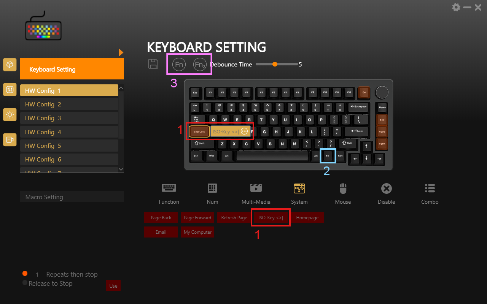

# HJS AL75 & Weikav Lucky65 Keymap Patch – ISO key `<>|` and remappable Fn key

The **HJS AL75** and the **Weikav Lucky65 (v1)** in their ANSI versions have no ISO key, also called the 102nd key (`<>|` on a German layout). Their vendor software cannot assign that key to another key either, and it locks the Fn key and the Fn layers.

This small Python script patches the vendor software and unlocks all three. The same software also ships with the **HJS AL65**, **HJS AL70**, **Weikav Sugar65** and **Weikav D75**, so the script should work for them as well.

## What gets unlocked



| | Option | What it unlocks |
|---|---|---|
| 1 | `--iso` | The ISO key `<>\|` (Non-US Backslash, `KC_NUBS` in QMK firmware) becomes an assignable function in the **System** tab. It replaces the rarely used "Benchmark" function (a mistranslation of "Browser Favorites"). |
| 2 | `--fn-key` | The Fn key itself can be remapped, for example to Right Alt (AltGr in most European layouts). Put Fn on another key with the **Fn** button in the **Function** tab. |
| 3 | `--fn-layers` | The Fn layers can be edited right away. Without the patch, the software only allows that after you have assigned Fn to another key in addition to the existing Fn key. |

What the ISO key types depends on your keyboard layout:

| Layout | The ISO key types |
|---|---|
| German, Austrian, Swedish, Finnish | `<` `>` `\|` |
| French, Spanish, Italian, Portuguese | `<` `>` |
| Swiss | `<` `>` `\` |
| UK, Irish | `\` `\|` |

Also known as: 102nd key, ISO key, Non-US backslash, `<>` key · Taste `<>` · touche `<>` · tecla `<>` · tasto `<>` · tangent `<>`

## Supported keyboards

| Keyboard | Program | `--iso` | `--fn-key` | `--fn-layers` | Tested |
|---|---|---|---|---|---|
| [HJS AL75 V2](https://hjskeys.com/software-firmware/) | `AL75_3M Keyboard.exe` | ✓ | ✓ | ✓ | ✓ |
| [Weikav Lucky65 (v1)](https://weikav.com/waikv-software/) | `lucky65_3M keyboard.exe` | ✓ | ✓ | ✓ | ✓ |
| [HJS AL65 Wireless](https://hjskeys.com/software-firmware/) | `AL65_3M Keyboard.exe` | ✓ | not needed¹ | ✓ | |
| [HJS AL70](https://hjskeys.com/software-firmware/) | `AL70_3M Keyboard.exe` | ✓ | not needed¹ | ✓ | |
| [Weikav D75](https://weikav.com/waikv-software/) | `D75 Keyboard.exe` | ✓ | not needed¹ | ✓ | |
| [HJS AL65 Wired](https://hjskeys.com/software-firmware/) | `AL65_Series.exe` | ✓ | not needed¹ | –² | |
| [Weikav Sugar65](https://weikav.com/waikv-software/) | `L66_Series.exe` | ✓ | not needed¹ | –² | |

¹ The Fn key is already clickable in this software (not tested with the keyboard).
² This software has no Fn layer buttons.

**Tested** means tested on Windows 11 with my own [HJS AL75 V2](https://keyshelf.app/en/gallery/Olli/75) and [Weikav Lucky65](https://keyshelf.app/en/gallery/Olli/97). For the other programs, the installer was unpacked without running it, and the patches were applied and reverted. If you own one of these keyboards, please open an issue and report whether it works.

**Weikav Lucky65:** The patch is for the **Lucky65 v1**, which you set up with the Weikav software (`lucky65_3M keyboard.exe`). The Lucky65 v2 and v3 use VIA, which can assign the ISO key directly.

**Not compatible** (different software): HJS AL75 v1, Weikav WK75 and WK68 (`OemDrv.exe`), Weikav ONE75 (`DeviceDriver.exe`), Weikav WK100 ("ROYUAN Driver"). The **YUNZII AL75** is a different keyboard from another brand.

## Usage

**Requirements:**
- Windows with one of the programs above installed
- Python 3.6 or newer. Get it from [python.org](https://www.python.org/downloads/), with `winget install Python.Python.3.14`, or as "Python" from the Microsoft Store.
- Administrator rights, because the software is installed under `C:\Program Files (x86)`

**Steps:**

1. Download [`keymap_patch.py`](keymap_patch.py).
2. **Quit the keyboard software completely**, including its tray icon. It starts with Windows, so check the tray even if you did not open it.
3. Open a terminal **as administrator**: Start menu → type `cmd` → right-click "Command Prompt" → "Run as administrator".
4. Run the script (adjust the path to the script):
   ```
   python "C:\path\to\keymap_patch.py" "C:\Program Files (x86)\AL75_3M Keyboard\resources\app.asar" --all
   python "C:\path\to\keymap_patch.py" "C:\Program Files (x86)\Lucky65_3M RGB Mechanical Keyboard\resources\app.asar" --all
   ```
   The first line is for the AL75, the second for the Lucky65. For other keyboards, use `resources\app.asar` in the installation folder of their software. To find that folder, right-click the program's shortcut and choose "Open file location".

   Expected output:
   ```
   iso: /backend/others/SupportData.js patched @ ...
   iso: /components/i18n_Localization.js patched @ ...
   fn-key: /components/app.component.html patched @ ...
   fn-layers: /components/app.component.html patched @ ...
   Done.
   ```
5. Start the keyboard software, open **Keyboard Setting** and assign the unlocked functions (see the picture above). Apply the settings to the keyboard.

Tip: put the ISO key on Caps Lock and Caps Lock on Fn + Caps Lock in the Fn layer. Then you can still use Caps Lock.

**All options:**

| Option | Effect |
|---|---|
| (none) | Show which patches are applied. Changes nothing and needs no administrator rights. |
| `--iso`, `--fn-key`, `--fn-layers` | Apply only these patches |
| `--all` | Apply all patches available in this software |
| `--revert` | Undo the selected patches, e.g. `--all --revert` |

## Undo and software updates

To undo, run the same command with `--revert`, e.g. `--all --revert`. Quit the keyboard software first and use an administrator terminal, as when patching. Before undoing, give keys that use an unlocked function their normal function again and switch the software back to the base layer (see [FAQ](#faq)). The script reminds you of this after undoing.

An update or reinstall of the keyboard software removes the patches. Run the script again afterwards.

## FAQ

**Can I also unlock Mute or Calculator?** No. The software has these functions, but the keyboard firmware does not understand their codes. The key then does nothing.

**I moved Fn and now I have no Fn key.** Reassign it in the software. The software does not need an Fn key.

**The software is stuck on an Fn layer.** This happens after `--revert` or a software update: the software reopens the last layer and locks the layer buttons again. Apply `--fn-layers` again, switch to the base layer, then undo it if you like.

**The status says "not available in this software".** This software does not have that lock (see the table), or it is a version the script does not know. The script never changes anything it does not recognize.

**My keyboard or software is not listed.** Run the script without options. It only shows the status and changes nothing. If it shows `not applied` for a patch, that patch will probably work. Please open an issue and report the result.

## How it works

The keyboard software is an Electron app. Its code is in `resources\app.asar`. The script replaces a few bytes in it, and each replacement has the same length as the original, so the archive stays valid. It checks every pattern before writing and stops without changes if anything is unexpected. The keyboard firmware is not modified.

Details for the curious, including a hidden developer mode of the software: [docs/technical-details.md](docs/technical-details.md)

## About the manufacturer names

Both brands appear online under several names:

| Name | Notes |
|---|---|
| **HJS** | Short form used in product names, e.g. "HJS AL75 V2" |
| **Heiji Snake** | Full English brand name |
| **HJ Snake** / **HJSnake** | Common in shop listings and reviews, e.g. "HJ Snake AL75" |
| **HEIJISHE** | Pinyin of the Chinese name |
| **黑吉蛇** | Chinese brand name (hēi jí shé, 蛇 = "snake") |
| **HJS Keys** / **HJSkeys** | Name used on hjskeys.com |
| **Weikav** / **WEIKAV** | Brand of the Lucky65, Sugar65 and D75 |
| **Waikv** | Spelling used on Weikav's download page |
| **Lucky65** / **Lucky 65** / **Lucky-65** | The v1 software and its folders use the name `Lucky65_3M` |

## Summary in German / Kurzfassung auf Deutsch

Auf ANSI-Tastaturen wie der HJS AL75 und der Weikav Lucky65 (v1) fehlt die Taste `<>|`, und die Herstellersoftware kann sie auch keiner anderen Taste zuweisen. Dieses Skript schaltet sie in der Software frei, außerdem lassen sich die Fn-Taste und die Fn-Ebenen belegen. Software beenden, Eingabeaufforderung als Administrator öffnen und ausführen:

```
python "C:\Pfad\zu\keymap_patch.py" "C:\Program Files (x86)\AL75_3M Keyboard\resources\app.asar" --all
```

Danach in der Software im Tab „System“ die Funktion „ISO-Key <>|“ einer Taste zuweisen. Rückgängig machen mit `--all --revert`.

## License

[MIT](LICENSE)

## Disclaimer

This is an unofficial community patch. It is not affiliated with or endorsed by HJS / Heiji Snake (黑吉蛇) or Weikav. You use it at your own risk. The script only modifies the desktop software, not the keyboard firmware, and you can undo it with `--revert` or by reinstalling the software.
