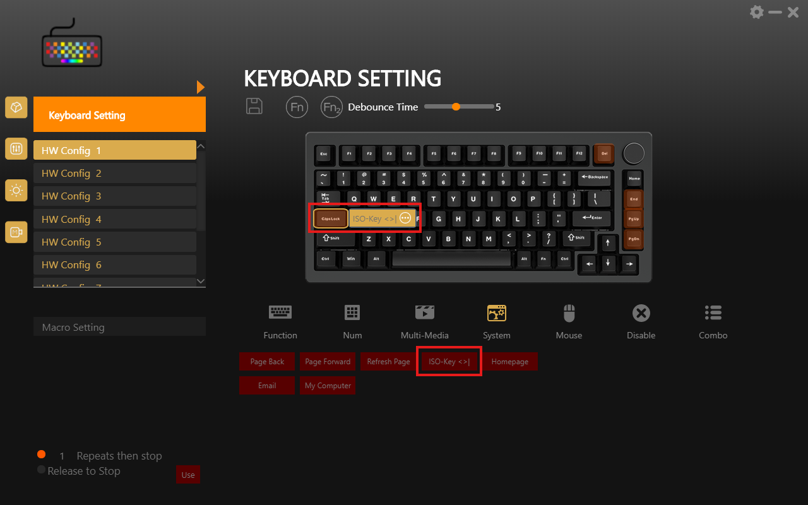

# HJS & Weikav ISO Key Patch – add the `<>|` key to the HJS AL75, AL65, AL70 and Weikav Lucky65 keyboard software

The **HJS AL75** (also sold as **HJ Snake AL75** or **Heiji Snake AL75**) is a 75% aluminum mechanical keyboard with an ANSI layout (82 keys plus a knob). ANSI layouts have no physical ISO key (`<>|` on a German layout). Its vendor software, "AL75_3M Keyboard", cannot assign that key to any other key either: the key code it needs is missing from the software.

This small Python script patches the HJS AL75 software. Afterwards you can map the **Non-US Backslash** key (NUBS, HID usage `0x64`, called `KC_NUBS` in QMK) to any key, for example Caps Lock.

The same vendor software also ships, under other names, with the **HJS AL65**, **HJS AL70**, **Weikav Lucky65** (v1), **Weikav Sugar65** and **Weikav D75**. The patch works for all of them.

## Supported keyboards

| Keyboard | Program file | Download | Status |
|---|---|---|---|
| HJS AL75 V2 | `AL75_3M Keyboard.exe` | [hjskeys.com](https://hjskeys.com/software-firmware/) (`AL75V2.exe`) | tested |
| HJS AL65 Wireless | `AL65_3M Keyboard.exe` | [hjskeys.com](https://hjskeys.com/software-firmware/), [weikav.com](https://weikav.com/waikv-software/) | patch applies |
| HJS AL65 Wired | `AL65_Series.exe` | [hjskeys.com](https://hjskeys.com/software-firmware/) | patch applies |
| HJS AL70 | `AL70_3M Keyboard.exe` | [hjskeys.com](https://hjskeys.com/software-firmware/) | patch applies |
| Weikav Lucky65 (v1) | `lucky65_3M keyboard.exe` | [weikav.com](https://weikav.com/waikv-software/) | patch applies |
| Weikav Sugar65 | `L66_Series.exe` | [weikav.com](https://weikav.com/waikv-software/) | patch applies |
| Weikav D75 | `D75 Keyboard.exe` | [weikav.com](https://weikav.com/waikv-software/) | patch applies |

**Tested:** The patched software was used with an HJS AL75 V2 (ANSI) on Windows 11, and the key types `<`, `>` and `|`.

**Patch applies:** The installer was unpacked without running it, and the patch was applied to its files and reverted again. Nobody has tried the patch with one of these keyboards yet. If you own one, please open an issue and report whether it works.

HJS and Weikav ship the same software for all of these keyboards; only the name and the keyboard layout differ. The "3M" versions even talk to the same USB device ID (`0603:0351`).

AL75 variants sold under other names, such as the ACGAM HJ Snake AL75 or "AL75 3 Mode" listings, may use the same software as well. If your software is not listed, just run the script: it refuses to change anything it does not recognize.

**Not compatible** (different software):

- **HJS AL75 v1**, Weikav WK75 and Weikav WK68 use an older program (`OemDrv.exe`).
- Weikav ONE75 (`DeviceDriver.exe`) and Weikav WK100 ("ROYUAN Driver") use other vendor software.
- Weikav Lucky65 v2 and v3 use VIA. VIA can assign the ISO key directly, so they do not need a patch.
- The **YUNZII AL75** is a different keyboard from another brand with its own software.

## The problem

The ISO layouts used in Germany, Austria, Switzerland, France, the Nordic countries and elsewhere have one more key than ANSI layouts. It sits between the left Shift and the Z key and is often called the "102nd key". On a German layout it types `<`, `>` and `|`. An ANSI keyboard such as the HJS AL75 does not have this key, so you need to remap it onto another key.

The HJS AL75 software lets you assign many keys and functions, but the ISO key is not among them. The software stores key assignments as internal codes (`K1`, `K2`, …) and looks up the matching USB HID code in a built-in table. That table has no entry for `0x64`, so editing a saved profile (`.KeyAssign` file) does not help either.

## What the patch does

The patch repurposes the function button **"Benchmark"** (`K44`). Despite its English label, it is meant to be "Browser Favorites" (Chinese: 瀏覽器收藏); the label is a translation error. The patch changes it in the software's `app.asar` file:

| | Before | After |
|---|---|---|
| Key code that the button sends | `0xAD` (Browser Favorites) | `0x64` (Non-US Backslash) |
| Label, English | `Benchmark` | `ISO-Key <>\|` |
| Label, Chinese (Traditional) | `瀏覽器收藏` | `ISO鍵 <>\|` |
| Label, Chinese (Simplified) | `浏览器收藏` | `ISO键 <>\|` |
| Label, Italian | `Riferimento` | `Tasto ISO <>\|` |
| Label, Spanish | `Punto de referencia` | `Tecla ISO <>\|` |

The keyboard firmware itself is not modified. Both changes keep the original byte length, so nothing else in the archive moves.

Side effect: the "Benchmark" / Browser Favorites function is no longer available while the patch is applied. Windows passes it on to the active browser, and most browsers do nothing with it.

## Requirements

- Windows with the HJS AL75 software "AL75_3M Keyboard" installed (default folder `C:\Program Files (x86)\AL75_3M Keyboard\`), or one of the related programs listed under [Supported keyboards](#supported-keyboards)
- [Python 3.6 or newer](https://www.python.org/downloads/), no additional packages
- Administrator rights, because the software is installed under `C:\Program Files (x86)`

## Usage

1. **Quit the keyboard software completely**, including its tray icon. It starts automatically with Windows, so check the tray even if you did not open it.
2. Download [`nubs_patch.py`](nubs_patch.py) from this repository.
3. Open a terminal **as administrator**: Start menu → type `cmd` → right-click "Command Prompt" → "Run as administrator".
4. Optional: make a backup of the original file:
   ```
   copy "C:\Program Files (x86)\AL75_3M Keyboard\resources\app.asar" "%USERPROFILE%\app.asar.bak"
   ```
5. Run the patch (adjust the path to the script):
   ```
   python "C:\path\to\nubs_patch.py" "C:\Program Files (x86)\AL75_3M Keyboard\resources\app.asar"
   ```
   Expected output:
   ```
   /backend/others/SupportData.js: patched @ ...
   /components/i18n_Localization.js: patched @ ...
   Done.
   ```
   For a different keyboard, use the `resources\app.asar` in the installation folder of its software. To find that folder, right-click the program's shortcut and choose "Open file location".
6. Start the keyboard software. Below the keyboard image, open the **System** tab (Page Back, Page Forward, Refresh Page, …). The button that used to say "Benchmark" now says **"ISO-Key <>|"**. Assign it to the key of your choice and apply the settings to the keyboard.

   
7. Test it: with a German layout the key should type `<`, with Shift `>` and with AltGr `|`. Other ISO layouts produce whatever character they put on the 102nd key (for example `\` and `|` on UK English).

Tip: if you put the ISO key on Caps Lock, you can assign Caps Lock to Fn + Caps Lock on the Fn layer, so you can still use it.

## Undo the patch

```
python "C:\path\to\nubs_patch.py" "C:\Program Files (x86)\AL75_3M Keyboard\resources\app.asar" --revert
```

Quit the keyboard software first and use an administrator terminal, as when patching.

## After a software update

An update or reinstall of the keyboard software replaces `app.asar`, which removes the patch. Run the script again afterwards. If you then change anything in the unpatched software, it sends the original code (`0xAD`, "Benchmark") to the keyboard again.

## Safety

- The script checks every file before writing anything. If it does not find the expected bytes exactly once, for example because of a different software version, it stops with an error message and changes nothing.
- Running it twice does no harm. Already patched files are reported as `already done`.

## How it works

The keyboard software is an Electron app. Its JavaScript code is packed into `resources\app.asar`, a simple archive format: a JSON index followed by the file contents. The script reads the index, locates two files inside the archive and replaces one byte pattern in each:

- `backend/others/SupportData.js` contains the table `AllFunctionMapping`, which maps internal key codes (`K44`) to the codes sent to the keyboard. Here `'hid':0xad,` becomes `'hid':0x64,`.
- `components/i18n_Localization.js` contains the UI texts. Here the entry `BROWSERCOLLECT` gets the new labels in all five languages. The new labels are shorter than the old ones; the remaining bytes are filled with spaces inside the JavaScript code, outside the quotes, so they do not show up on the button.

Because both replacements have the same length as the original, the archive index stays valid and no repacking is needed.

## About the manufacturer names

The manufacturer appears online under several names, all for the same Chinese keyboard brand:

| Name | Notes |
|---|---|
| **HJS** | Short form used in product names, e.g. "HJS AL75 V2" |
| **Heiji Snake** | Full English brand name |
| **HJ Snake** / **HJSnake** | Common in shop listings and reviews, e.g. "HJ Snake AL75" |
| **HEIJISHE** | Pinyin of the Chinese name |
| **黑吉蛇** | Chinese brand name (hēi jí shé, 蛇 = "snake") |
| **HJS Keys** / **HJSkeys** | Name used on hjskeys.com |

## License

[MIT](LICENSE)

## Disclaimer

This is an unofficial community patch. It is not affiliated with or endorsed by HJS / Heiji Snake (黑吉蛇) or Weikav. You use it at your own risk. The script only modifies the desktop software, not the keyboard firmware, and you can undo it with `--revert` or by reinstalling the software.
